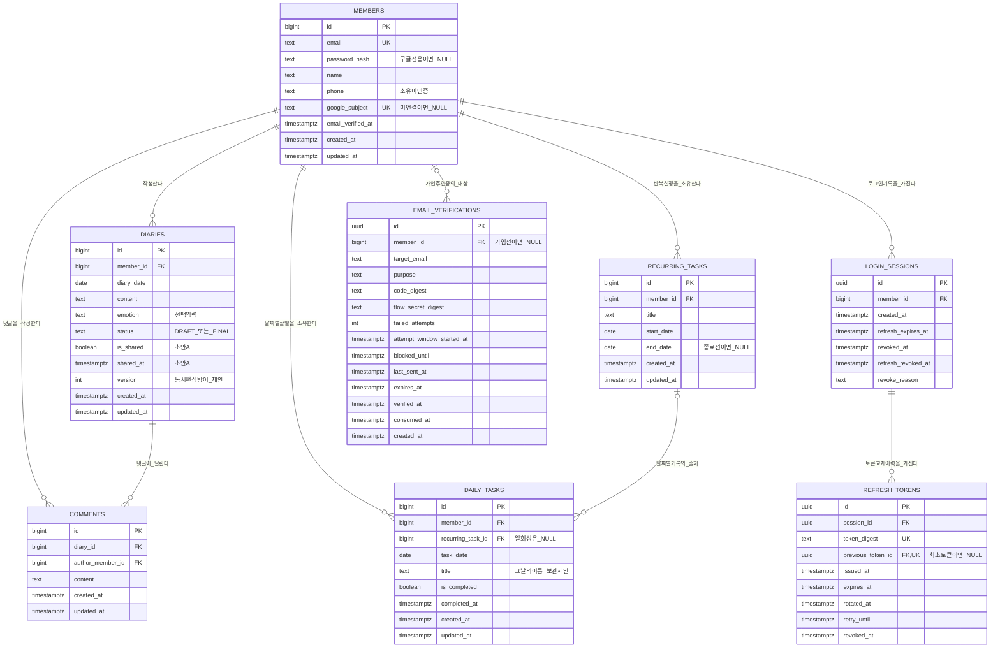
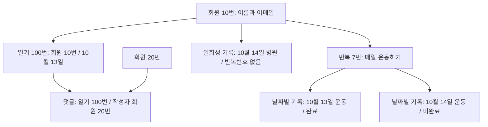
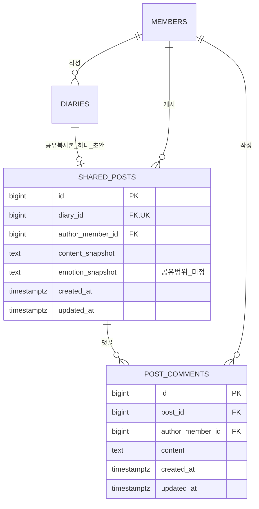

# 회원가입·로그인 설계 계획서

작성일: 2026-10-12 / 최종 갱신: 2026-10-13

**인증 정책의 현재 결정은 16절을 우선한다. 전체 데이터 스키마·Mermaid 관계도는 17절의 초안이다.** 앞 절은 논의 과정과 이전 상태를 포함하며, 16절에서 확정한 항목은 더 이상 미정으로 취급하지 않는다.

이 문서는 대화에서 합의한 회원가입·로그인 설계를 기록한다. 코드 구현 완료를 의미하지 않는다. 확정한 정책, 구현을 위한 초안, 미결정 사항을 구분한다. 후속 로그인 논의는 10절 이후에 기록하며, 앞 절의 로그인 미정 설명보다 우선한다.

## 1. 과제 목적과 범위

- 회사에서 제시한 조건은 웹사이트 구현, DB 설계, API 서버 구축, 회원가입이다.
- 작은 일기·커뮤니티 서비스는 회원가입과 회원 관리를 학습하기 위한 배경이다.
- 기능 구현뿐 아니라 선택 이유, 대안, 감수한 한계와 검증 방법을 설명하는 것을 목표로 한다.
- 회원가입 수단은 자체 이메일·비밀번호 가입과 Google 가입 두 가지다.
- 후속 로그인 설계는 10절 이후에 정리한다. 로그인 실패 제한의 확정 기준은 16절에 기록한다.

## 2. 확정한 결정

| 항목 | 결정 | 선택 이유와 한계 |
|---|---|---|
| 수집 정보 | 이메일, 비밀번호(자체 가입), 이름, 전화번호를 다룬다 | 회원 데이터와 인증을 학습하기 위한 범위다. 이름 입력은 실명 인증이 아니고 전화번호 입력은 번호 소유 인증이 아니다. |
| 이메일 확인 | 이메일로 보낸 인증번호를 홈페이지 화면에 입력한다 | 다른 기기에서 메일을 확인해도 가입하던 화면에서 계속 진행할 수 있다. 메일 접근 여부만 확인하며 실제 신원이나 일인 일계정을 보장하지 않는다. |
| 문자 인증 | 이번 범위에서는 사용하지 않는다 | 예산 제약을 반영한다. 전화번호는 미인증 정보로 취급한다. |
| 회원 생성 시점 | 이메일 인증 후 나머지 정보를 제출할 때 정식 회원을 생성한다 | 미인증 신청을 정식 회원과 구분한다. 서버가 인증 결과를 최종 가입 요청까지 연결해야 한다. |
| 인증 정보 저장소 | 기존 DB의 별도 인증 테이블을 사용한다 | Redis 등 추가 저장소 없이 구현·운영을 단순화한다. 만료 검사와 기록 정리는 직접 구현해야 한다. |
| 인증 메일 발송 | 메일 업체의 발송 요청 결과를 기다린 뒤 응답한다 | 초기 구현이 단순하고 요청 실패를 안내하기 쉽다. 기다리는 시간을 제한하고 실패 시 재요청을 제공한다. 업체의 접수 성공은 메일함 도착 보장이 아니다. |
| 자동 가입 방지 | 모든 가입자에게 캡차 검사를 적용하는 방향이다 | 자동 가입·남용 방어를 위한 공통 검사다. 제품과 Google 경로의 구체적인 적용 위치는 미정이다. |
| 인증번호 재발급 | 새 번호 발급 시 이전 번호는 더 이상 인정하지 않는다 | 유효한 번호를 최신 것으로 제한한다. 이전 번호 입력 시 오류로 처리한다. 늦게 도착한 메일로 인한 혼란은 안내가 필요하다. |
| 인증 실패 횟수 | 재발급해도 일정 시간 동안의 실패 횟수를 유지한다 | 재전송으로 입력 횟수 제한을 우회하지 못하게 한다. 횟수와 시간 등 수치는 미정이다. |
| 비밀번호 보관 | 비밀번호 전용 해시를 사용한다 | 원문 비밀번호를 저장하지 않는다. 알고리즘, 라이브러리, 비용 설정은 미정이다. |
| 기존 계정과 Google 연결 | 이메일 일치만으로 자동 연결하지 않는다. 기존 계정 확인과 연결 동의 후 Google 로그인 수단을 추가한다 | 기존 회원·게시글은 유지하고 로그인 방법만 늘린다. 기존 이메일·비밀번호 회원은 비밀번호 재확인을 거친다. |

캡차나 이메일 인증 하나만으로 자동화 공격이나 계정 탈취가 완전히 방지되지는 않는다.

## 3. 자체 가입 흐름

1. 사용자가 이메일을 입력하고 인증번호 발송을 요청한다.
2. 서버가 요청을 검증한다. 캡차 검증, 발송 빈도 제한의 구체적인 기준은 추가 설계한다.
3. 서버가 이메일과 가입 요청에 연결된 인증 정보를 별도 DB 테이블에 기록하고 메일 발송을 요청한다.
4. 화면에는 메일 업체의 요청 처리 결과를 안내한다. 실패나 시간 초과 시 재요청 흐름을 제공한다.
5. 사용자가 홈페이지에 인증번호를 입력한다.
6. 서버가 요청과 이메일의 일치, 코드, 만료, 실패 제한, 사용 여부를 확인한다.
7. 인증 성공 후 이름·전화번호·비밀번호 등 나머지 정보를 제출한다.
8. 서버가 이 가입 요청에 유효한 이메일 인증 결과가 있는지 최종 확인한다. 이메일을 변경했다면 재인증이 필요하다.
9. 비밀번호 해시와 회원 정보를 저장하고 인증 결과를 소비 처리한다.

‘인증 완료’라는 화면 값만 신뢰하지 않는다. 최종 가입과 인증 결과 소비를 어떻게 하나의 처리로 보장할지는 구현 전 결정한다. 가입 후 자동 로그인 또는 로그인 화면 이동도 미정이다.

## 4. Google 가입과 기존 회원 연결

### 새 Google 회원

- Google이 사용자 인증을 수행한다. 우리 서비스는 Google 비밀번호를 받거나 저장하지 않는다.
- 서버는 Google 인증 결과의 진위와 우리 서비스용인지 등을 검증한다.
- 검증된 Google 계정 고유 식별자로 연결 관계를 조회한다. 이메일만으로 외부 계정을 식별하지 않는다.
- 이름·전화번호 등 우리 서비스에 필요한 추가 정보를 확인한다. 기본 Google 로그인으로 전화번호나 인증된 실명을 확보했다고 가정하지 않는다.
- 필요한 가입 요건을 갖추면 내부 회원과 Google 로그인 수단의 관계를 저장한다.

Google이 제공하는 이메일 검증 정보를 어떤 조건에서 인정하고 자체 이메일 인증을 생략할지는 아직 미정이다. Google 가입자에게 자체 비밀번호를 의무적으로 만들게 하지는 않는 방향으로 설명했으며, 데이터 모델은 비밀번호 없는 회원을 표현할 수 있어야 한다.

### 이미 자체 가입한 회원과 이메일이 겹치는 경우

1. 이메일 일치만으로 기존 계정 접근을 허용하지 않는다.
2. 기존 계정의 비밀번호로 재확인한다.
3. 검증된 Google 계정을 연결할지 사용자 동의를 받는다.
4. 기존 내부 회원에 Google 로그인 수단을 추가한다.
5. 이후 두 방식 모두 같은 내부 회원과 게시글에 연결된다.

이미 생성된 별도 회원 두 개의 데이터 병합은 이번에 합의한 ‘로그인 수단 연결’과 다른 기능이며 범위에 포함하지 않는다. 연결 취소, 마지막 로그인 수단 삭제, 계정 복구 정책은 별도 논의한다.

## 5. DB 설계 초안 — 아직 확정하지 않은 세부 구조

확정한 것은 ‘회원 정보와 임시 인증 정보의 분리’다. 아래 엔티티와 필드는 구현 검토용 초안이며 최종 스키마가 아니다.

| 대상 | 책임 | 검토할 정보 |
|---|---|---|
| 회원 | 서비스 안에서 동일한 회원을 식별하고 프로필 관리 | 내부 회원 ID, 이메일, 이름, 전화번호, 상태, 생성 시각 |
| 로그인 수단 | 내부 회원과 비밀번호·Google 인증 수단을 연결 | 회원 ID, 제공자, 제공자 계정 ID, 자체 비밀번호 해시 등 |
| 이메일 인증 요청 | 가입 전 코드 발급과 검증 결과 관리 | 요청 ID, 이메일, 코드 검증값, 만료 시각, 인증 시각, 소비 시각 |
| 남용 제한 기록 | 재발급과 독립적으로 실패·발송 횟수 관리 | 집계 대상, 기간, 실패 수, 발송 수, 제한 종료 시각 |

남용 제한 기록을 별도 테이블로 만들지, 인증 데이터와 함께 관리할지는 미정이다. 재발급 시 행을 교체하더라도 실패 횟수가 초기화되지 않도록 해야 한다.

## 6. 구현 전에 남은 결정

- 인증번호 길이·유효기간·실패 횟수·차단 시간·재전송 간격. 대화에서 언급한 10분과 5회는 예시이지 확정값이 아니다.
- 인증번호와 인증 완료 증표의 생성·저장·보호 방식. 짧은 코드에 단순 해시만 적용하면 충분하다고 가정하지 않는다.
- 이메일 인증 완료를 최종 가입 요청과 연결하는 방법, 결과의 만료와 일회용 소비 방식.
- 회원 생성과 인증 결과 소비의 원자성, 동시 가입 요청에 대한 DB 고유 제약 및 충돌 처리.
- 이메일 비교·정규화 규칙과 기존 회원이 있는 경우의 안내 정책.
- 인증 기록 보관·삭제 기간. 만료된 요청 거절과 물리적 삭제는 구분한다.
- 메일 발송 업체, 요청 시간 제한, 실제 발송 여부가 불명확한 시간 초과의 재시도 정책.
- 캡차 제품, 서버 검증, 각 가입 경로의 적용 위치, 실패·장애 시 동작.
- 비밀번호 해시 알고리즘과 검증된 라이브러리, 안전한 설정, 비밀번호 정책.
- 개인정보 공개 범위와 운영자 접근, 로그에서 코드·비밀번호·불필요한 개인정보 제외.
- 가입 후 자동 로그인 여부. 토큰 기반 로그인과 HttpOnly 쿠키 보관은 후속 논의에서 선택했으며, 만료·갱신·폐기의 구체적인 정책은 10절 이후를 따른다.

## 7. 시니어 검토에서 설명할 핵심

1. **왜 인증 후 회원을 생성하는가?** 정식 회원과 미인증 신청을 구분하기 위해서다. 대신 인증 결과를 가입까지 안전하게 연결할 책임이 생긴다.
2. **왜 인증 정보를 기존 DB에 두는가?** 이번 규모에서는 별도 저장소 운영 부담을 줄이기 위해서다. 대신 만료와 정리를 직접 관리한다.
3. **왜 메일 발송 요청 결과를 기다리는가?** 구현과 실패 안내를 단순화하기 위해서다. 대신 외부 서비스 지연의 영향을 받는다.
4. **왜 재발급해도 실패 횟수를 유지하는가?** 재발급으로 제한을 우회하지 못하도록 하기 위해서다.
5. **왜 같은 이메일의 Google 계정을 바로 합치지 않는가?** 기존 계정 접근 권한을 확인한 뒤 로그인 수단을 추가하기 위해서다. 대신 연결 절차가 추가된다.

## 8. 구현 시 검증할 시나리오

- 인증하지 않은 가입 요청과 인증 후 이메일을 변경한 요청이 거절된다.
- 최신 코드만 통과하고 이전·만료·사용 완료 코드는 거절된다.
- 코드 재발급이 실패 횟수 제한을 초기화하지 않는다.
- 동일 인증 결과를 이용한 동시 가입 요청이 중복 회원을 만들지 않는다.
- 메일 업체 지연·실패 시 요청이 무한정 대기하지 않고 재시도 가능한 안내가 나온다.
- 화면 검사를 우회한 요청에도 서버가 캡차와 인증 요건을 검증한다.
- Google 인증 결과를 검증하고, 이메일 일치만으로 기존 회원 접근을 허용하지 않는다.
- 연결 후 자체 로그인과 Google 로그인이 같은 내부 회원으로 이어진다.
- 응답과 로그에 비밀번호·해시·인증번호 등 비밀 정보가 노출되지 않는다.

## 9. 참고 자료

- [OWASP 이메일 검증 지침](https://cheatsheetseries.owasp.org/cheatsheets/Email_Validation_and_Verification_Cheat_Sheet.html)
- [OWASP 비밀번호 저장 지침](https://cheatsheetseries.owasp.org/cheatsheets/Password_Storage_Cheat_Sheet.html)
- [Google 로그인 공식 문서](https://developers.google.com/identity/openid-connect/openid-connect)
- [Cloudflare Turnstile 서버 검증 문서](https://developers.cloudflare.com/turnstile/get-started/server-side-validation/)

제품 문서는 구현 시 참고할 자료이며, 특정 제품 채택을 확정한 것은 아니다.

## 10. 후속 로그인 설계 결정

이 절은 앞 절에 기록한 로그인 방식 미정 상태를 갱신한다.

- **결정:** 학습 목적으로 서명된 토큰 기반 인증을 선택한다.
- **비교 판단:** 현재 작은 단일 웹서비스에서는 서버 세션이 로그인 상태 관리와 즉시 취소를 더 단순하게 구현할 수 있다.
- **선택 이유:** 이번 과제는 웹 개발 학습이 목적이므로 토큰 발급·검증·만료·재발급·로그아웃을 설계하며 인증 구조와 보안상 책임을 이해하고자 한다.
- **감수하는 한계:** 발급한 토큰의 만료 전 취소와 재발급 관리 등이 복잡해질 수 있다. 토큰이 무조건 더 안전하거나 빠르다는 주장은 선택 근거로 사용하지 않는다.
- **추가 결정:** 로그인 토큰은 웹페이지 JavaScript에서 읽지 못하도록 `HttpOnly`를 설정한 쿠키에 보관·전달한다. 로컬 스토리지 보관 방식은 선택하지 않는다. 쿠키 사용이 서버 세션으로의 변경을 의미하지는 않는다.
- **저장 방식 선택 이유:** 화면 코드가 토큰 값을 직접 읽을 필요가 없으므로, 악성 스크립트의 토큰 값 직접 탈취 경로를 줄인다. XSS 자체나 사용자 브라우저에서의 악성 요청까지 막는 것은 아니다.
- **함께 구현할 책임:** 쿠키 자동 전송에 따른 CSRF 방어와 안전한 쿠키 설정을 함께 구현한다. 구체적인 설정과 방어 방식은 후속 설계한다.
- **미정:** 구체적인 토큰 형식·라이브러리, 검증 정책, 유효기간, 로그아웃·탈퇴 시 무효화 정책. 재발급 흐름은 아래 초안으로 구체화했으며 세부 정책은 추가 결정한다.

## 11. 토큰에 대한 공통 이해

- 로그인 토큰은 이후 API 요청에서 사용자를 확인하기 위해 서버가 발급하는 데이터다. 일기 본문 끝에 붙이는 내용이 아니다.
- 자체 로그인 또는 검증된 Google 로그인으로 내부 회원을 확인한 후, 우리 서비스의 로그인 증표를 발급하는 구조로 설계한다.
- 서명된 토큰은 서버가 서명을 검증하므로 토큰 원본을 DB에 저장하지 않고도 진위 검사를 할 수 있다. 다만 재발급·폐기·기기별 로그인 관리에는 서버 측 기록이 필요할 수 있다.
- 서명은 위조·변조 여부를 검증하는 수단이다. 탈취된 유효 토큰을 누가 사용하는지까지 구분해주지는 않는다.
- 서명된 토큰의 내용을 암호화된 비밀로 취급하지 않는다. 비밀번호나 일기 본문을 넣지 않는다.

### 브라우저 보관·전달 방식 비교

| 방식 | 동작 | 장점 | 한계 |
|---|---|---|---|
| 로컬 스토리지 | 브라우저에서 실행되는 코드가 토큰을 저장하고 읽어 요청의 인증 헤더에 붙인다 | 요청별 첨부를 코드에서 제어할 수 있다 | 해당 사이트에서 실행된 악성 스크립트가 토큰 값을 읽어 탈취할 수 있다 |
| HttpOnly 쿠키 — 선택 | 서버가 쿠키를 설정하고 브라우저가 조건에 맞는 요청에 자동으로 첨부한다 | 페이지 JavaScript가 토큰 값을 직접 읽지 못한다 | 자동 전송에 따른 CSRF 방어가 필요하며, XSS에 의한 사용자 권한 요청 자체를 막지는 못한다 |

둘 다 브라우저에 저장하는 방식이다. JavaScript는 언어이고, 개발자가 작성한 코드를 브라우저가 실행하여 저장소에 접근한다. HttpOnly는 페이지 코드의 쿠키 읽기를 제한하는 설정이지, 서버의 토큰 검증을 막거나 기기 전체의 탈취를 방지하는 기능이 아니다.

쿠키는 HTTPS 환경의 Secure 설정, 적절한 SameSite·범위 설정, 서버의 CSRF 방어를 함께 설계한다. 구체적인 배포 도메인과 프레임워크에 맞춘 구성은 미정이다.

## 12. 토큰 만료와 재발급 — 논의한 구현 초안

### 구분

- **접근용 토큰:** 일기 조회·작성·수정·삭제 같은 인증 필요 요청에 사용한다.
- **재발급용 토큰(리프레시 토큰):** 접근용 토큰이 만료됐을 때 새 접근용 토큰을 받는 데 사용한다.
- **토큰 만료:** 발급 시 정한 유효기간이 지나면 서버가 해당 토큰을 거절한다.
- **로그인 유지 정책:** 언제 다시 비밀번호 입력이나 Google 로그인을 요구할지를 정하는 별도 정책이다. 화면의 자동 로그아웃 카운트가 반드시 접근용 토큰 만료 시간과 같지는 않다.

### 현재 방향과 미확정 값

- 짧은 수명의 접근용 토큰과 자동 재발급을 조합하는 흐름을 논의했다. 재발급의 상세 보안 정책과 데이터 모델은 아직 확정하지 않았다.
- **접근용 토큰 15분은 제안값이며 확정값이 아니다.** 모든 서비스에 적합한 표준 시간으로 취급하지 않는다.
- 사용자는 별도의 로그인 만료 시간을 지금 정하지 않겠다고 했다. 이는 무기한 인증을 허용하기로 했다는 뜻이 아니다. 재발급용 토큰의 만료·취소 정책은 반드시 별도로 결정해야 한다.
- 글자를 입력하거나 사이트를 사용한다고 기존 서명 토큰의 만료 시간이 저절로 늘어나지 않는다. 새 토큰을 발급받으면 교체되는 것이다.
- 모든 API 응답에서 새 토큰이 자동 발급되는 것은 아니다. 만료 응답 후 재발급하거나, 만료 전 미리 재발급하도록 구현할 수 있다. 어떤 전략을 사용할지는 미정이다.
- 리프레시 토큰이 유효하면 비밀번호를 다시 입력하지 않고 새 접근용 토큰을 받을 수 있다. 만료·폐기 등으로 재발급이 거절되면 재로그인이 필요하다.

## 13. 작성 중 인증이 만료되어도 글을 잃지 않는 원칙

**확정한 사용자 경험 원칙:** 토큰 만료나 재인증 필요를 이유로 작성 중인 일기를 지우거나, 내용을 잃는 방식으로 로그인 화면에 이동시키지 않는다.

### 다섯 시간 동안 작성한 뒤 저장하는 예

1. 사용자가 로그인하고 일기를 작성한다.
2. 작성 중 접근용 토큰이 만료될 수 있다. 화면에서 글을 입력하는 것만으로 서버 요청이나 갱신이 발생한다고 가정하지 않는다.
3. 저장 시 토큰이 만료되었으면 작성 내용은 유지한다.
4. 재발급이 가능하면 새 접근용 토큰을 받아 저장 요청을 이어간다.
5. 재발급이 거절되면 작성 내용을 유지하면서 재로그인을 안내한다.
6. 재로그인 후 회원의 동일성과 저장 권한을 확인하고 사용자가 저장을 이어갈 수 있게 한다. 다른 회원으로 로그인했다면 이전 작성 내용을 자동으로 그 회원에게 저장하지 않는다.

위의 회원 동일성 검사 등은 합의한 글 보존 원칙을 구현하기 위한 보완 초안이다. 구체적인 재로그인 화면과 복구 동작은 아직 결정하지 않았다.

### 글 보존과 임시 저장의 차이

- 현재 화면에 글을 남겨두는 것만으로는 새로고침·탭 종료·브라우저 종료 후 복구를 보장할 수 없다.
- 이런 상황까지 보호하려면 브라우저 임시 저장 또는 서버 자동 저장 등을 별도로 설계해야 한다.
- **임시 저장 기능과 저장 위치는 아직 확정하지 않았다.** 일기 내용의 민감성, 공용 기기 노출, 로그아웃·탈퇴 시 삭제, 다른 계정과의 분리를 함께 검토한다.
- 서버 자동 저장을 도입하면 그 요청 과정에서 재발급을 처리할 수 있다. 단, 자동 저장이 실제로 구현되어 있거나 토큰이 무조건 연장된다고 가정하지 않는다.

## 14. 다음에 결정할 로그인 설계 항목

1. 접근용 토큰과 리프레시 토큰의 유효기간, 갱신 시점.
2. 리프레시 토큰의 서버 저장·회전·재사용 탐지·폐기 방식, 다중 탭에서의 동시 재발급 처리.
3. 쿠키의 범위·수명·보안 속성 및 CSRF 방어 방식.
4. 현재 기기 로그아웃, 전체 기기 로그아웃, 비밀번호 변경·탈퇴·정지 시 토큰 처리.
5. 만료 응답과 다른 권한 오류의 구분, 재발급 실패·네트워크 장애 처리, 무한 재시도 방지.
6. 일기 저장 재시도 시 중복 저장 방지 및 재로그인 후 동일 계정 확인.
7. 임시 저장 여부와 위치, 복구·삭제 정책.

### 추가 검증 시나리오

- 페이지 JavaScript에서 HttpOnly 토큰 값을 읽을 수 없고, 서버에서는 쿠키로 받은 토큰을 검증한다.
- 위조·변조·만료 토큰을 거절하고, 유효한 토큰이어도 남의 일기 접근을 허용하지 않는다.
- 작성 중 토큰이 만료되어도 화면의 글이 사라지지 않는다.
- 재발급 성공 후 저장이 이어지고, 재발급 실패 시 무한 반복 없이 재로그인을 안내한다.
- 재시도로 일기가 중복 생성되거나 다른 계정에 저장되지 않는다.

참고: [OWASP JWT 지침](https://cheatsheetseries.owasp.org/cheatsheets/JSON_Web_Token_Cheat_Sheet.html), [OWASP 세션 관리 지침](https://cheatsheetseries.owasp.org/cheatsheets/Session_Management_Cheat_Sheet.html).

## 15. 추가 합의 — 2026-10-13

이 절은 앞 절의 관련 미정·초안 상태를 갱신한다.

### 두 종류의 토큰과 재발급용 토큰 교체

- **결정:** 접근용 토큰과 재발급용 토큰을 사용하는 방향으로 진행한다. 접근용 토큰은 일기 전용이 아니라 서비스의 인증 필요 API 요청에 사용한다. 실제 접근 권한은 서버에서 별도로 확인한다.
- **결정:** 재발급 성공 시 새 접근용 토큰과 새 재발급용 토큰을 발급하고 이전 재발급용 토큰을 무효화한다(리프레시 토큰 회전).
- **선택 이유:** 동일한 재발급용 토큰을 유효기간 내내 반복 사용하도록 두지 않고, 이미 사용한 값의 재사용을 제한하기 위해서다.
- **한계:** 아직 사용되지 않은 토큰의 탈취까지 막지는 않는다. 다중 탭 동시 요청과 사용된 토큰 재등장 시 차단 범위는 추가 설계가 필요하다.
- **후속 선택 방향:** 통신 오류·응답 유실에 따른 정상 재시도를 위해 짧은 재사용 허용 시간을 둔다. 엄격히 모든 재사용을 즉시 차단하는 방식보다 불필요한 재로그인을 줄이는 것을 우선한다. 그 시간 안에는 탈취 토큰 재사용 위험도 남는다는 한계를 감수한다.
- **확정한 재시도 허용 시간:** 서버에서 토큰을 교체한 시점부터 5초 동안, 해당 로그인에서 직전에 교체된 재발급용 토큰의 재시도를 제한적으로 허용한다. 반복 요청으로 이 5초가 연장되지는 않는다. 이는 프로젝트 초기 정책이며 업계 공통 기준이라는 의미는 아니다.
- **확정한 재사용 대응:** 5초 허용 시간이 지난 뒤 이미 사용한 재발급용 토큰이 다시 제출되면, 해당 로그인에서 발급·교체된 재발급용 토큰 전체의 재발급 권한을 취소한다. 현재 새 토큰을 가진 쪽도 추가 재발급을 받을 수 없으며, 계속 이용하려면 재로그인이 필요하다. 다른 기기의 별도 로그인까지 일괄 취소하는 정책은 아니다. 이미 발급된 접근용 토큰의 즉시 차단 여부는 별도 미결정 사항이다.
- **구현 제안 — 세부 미확정:** 허용 시간 내 중복 요청에 동일 교체 결과를 재전달할지 등 일관성 처리 방법은 추가 결정한다. IP나 브라우저 정보 일치만으로 예외를 허용하지 않는다.
- **미정:** 회전과 별개인 재발급 최대 기간·미사용 기간. 새 토큰 발급 때 최대 기간을 늘리기로 합의한 것은 아니다. 접근용 15분과 재발급 허용 7일은 제안값이며 확정하지 않았다.

### 작성 내용 보존 흐름

- **확정:** 임시 저장한 초안은 서버 DB에 보관하여 다른 기기에서도 같은 계정으로 이어 쓸 수 있게 한다. 브라우저에만 두는 방식 대신 서버 저장을 선택했다.
- **기존 합의와의 관계:** 작성 중 브라우저에 자동 저장하는 복구용 사본은 별도 역할이다. ‘임시 저장’ 버튼은 서버 DB에 초안을 저장하고, ‘등록’은 현재 내용을 저장하면서 완성된 일기 상태로 처리한다. 서버 자동 저장 주기를 추가로 확정한 것은 아니다.
- 별도 확정용 DB가 필수인 것은 아니며 같은 DB에서 초안·완료 상태를 표현할 수 있다. 실제 스키마는 미정이다.
- 다른 기기에서는 서버에 마지막으로 저장된 초안까지만 이어 쓸 수 있다. 브라우저에만 남아 있는 변경분은 자동으로 다른 기기에 전달되지 않는다.
- **미정:** 브라우저 저장 기술·주기, 계정별 분리와 삭제, 서버 초안과 로컬 사본의 충돌 처리, 다중 탭·기기 동시 편집 처리.
- 30분 간격은 사용자가 의견을 물은 값이며 확정하지 않았다. 30초도 제안일 뿐이다. 작성 완료와 커뮤니티 공개 여부는 별개다.

## 16. 후속 대화 확정 사항 — 2026-10-13

이 절은 15절 이후의 대화를 반영한다. 설계 결정이며 구현 완료 보고가 아니다. 앞 절에서 미정이라고 적은 내용과 충돌하면 아래 결정을 우선한다.

### 프로젝트 범위와 기술

- 단기 학습 프로젝트로, 장래 확장만을 위한 구조 분리는 하지 않는다.
- 프런트엔드는 TypeScript, 백엔드는 Python을 사용한다. 프레임워크와 DB 제품은 아직 정하지 않았다.
- 회원 정보와 로그인 수단을 별도 테이블로 분리하는 제안은 채택하지 않았다. 회원 테이블에 회원 정보, 비밀번호 해시, Google 계정 식별 정보를 함께 둔다.
- Google로만 가입한 회원의 비밀번호 해시는 비어 있을 수 있다. 비밀번호 원문을 저장한다는 뜻이 아니다.
- 선택 이유: 이메일·Google 두 가지 로그인만 지원하는 현재 범위에서는 구현의 단순함을 우선한다. 로그인 수단 추가 시 스키마 변경 부담은 감수한다.

### 토큰 기간, 종료와 단일 로그인

- 접근용 토큰 유효기간은 **15분**, 재발급 허용 기간은 **최초 로그인부터 7일**로 진행한다. 재발급해도 최초 종료 시점은 늘리지 않는다. 업계 공통 기준이 아니라 이 프로젝트의 초기값이다.
- 7일 이후 새 토큰 발급은 거절한다. 마지막 접근용 토큰 만료를 7일 경계에 맞출지 등 정확한 경계 처리는 구현 시 명시한다.
- 로그아웃하면 해당 로그인의 접근용·재발급용 토큰을 모두 즉시 차단한다. 브라우저 쿠키 삭제만으로 끝내지 않는다.
- 서버에 로그인 종료 상태를 기록하고, 인증이 필요한 요청마다 토큰 검증과 함께 해당 로그인이 유효한지도 확인한다.
- 한 계정은 하나의 로그인만 유지한다. **새 로그인에 성공하면 이전 로그인의 두 토큰을 차단한다.** 로그인 실패만으로 이전 로그인을 종료하지 않는다.
- 이전 화면은 다음 서버 요청 시 종료 사실을 알 수 있다. 실시간 알림은 이번에 확정하지 않았다.
- 로그인이 종료돼도 작성 중인 일기는 지우지 않는다. 다시 로그인한 뒤 저장할 수 있도록 안내한다. 서버에 저장한 초안은 기기를 바꾸어 로그인해도 같은 회원의 데이터로 불러온다.
- 선택 이유: 사용자가 동시 로그인을 원하지 않아 단일 로그인을 선택했다. 기기를 바꿀 때 이전 기기에서 재로그인이 필요하다는 불편은 감수한다. 같은 브라우저의 여러 탭에서 생기는 편집 충돌까지 해결하는 정책은 아니다.
- 토큰 학습 목적은 유지하지만, 즉시 차단을 위해 서버 상태 조회도 사용한다. 완전히 상태 없는 인증 구조라고 설명하지 않는다.
- 기존 회전·5초 재시도 허용·허용 시간 이후 재사용 시 해당 로그인 재발급 차단 정책은 유지한다. **재사용 탐지 시 접근용 토큰까지 즉시 차단할지는 별도 확정되지 않았다.** 로그아웃·새 로그인·비밀번호 재설정의 즉시 차단 정책과 구분한다.

### 로그인 실패 제한과 비밀번호 복구

- 15분 안에 비밀번호를 5번 틀리면 30초 대기하게 한다. 계속 실패하면 대기를 늘리되 최대 5분으로 제한하고 영구 잠금은 하지 않는다.
- 계정과 접속 주소를 함께 고려한다. 정확한 증가 단계, 집계·초기화 방법, 두 기준의 조합은 구현 때 정한다. 접속 주소만으로 동일인을 판정하지 않는다.
- 선택 이유: 반복 추측을 늦추면서, 공격자가 일부러 실패시켜 계정을 영구적으로 잠그는 상황을 피한다. 일시적인 이용 방해까지 완전히 없어지는 것은 아니다.
- 자체 비밀번호를 잊으면 가입 이메일로 인증번호를 보내고 검증 후 새 비밀번호를 설정한다. 재설정이 완료되면 기존 토큰을 모두 차단하고 다시 로그인하게 한다.
- Google로만 가입한 회원에게는 자체 비밀번호를 새로 만들어주는 복구 흐름을 제공하지 않는다. Google 로그인으로 안내한다. Google 계정 자체의 복구는 Google에서 진행한다.
- 자체 가입 후 Google을 연결한 회원은 자체 비밀번호가 있으므로 기존 이메일 인증 재설정 흐름을 사용할 수 있다.
- 복구 화면에서 특정 이메일의 가입 여부·로그인 수단을 얼마나 노출할지와 안내 문구는 미정이다. 입력된 이메일만으로 본인임을 확인한 것으로 취급하지 않는다.

### 이메일 인증과 가입 완료

- 이메일 인증번호는 10분 동안 유효하며, 재전송은 최소 1분 간격으로 제한한다.
- 재전송하면 이전 번호는 무효가 되고, 일정 시간의 실패 횟수는 재전송으로 초기화하지 않는다.
- 가입용 인증번호와 비밀번호 재설정용 인증번호는 목적을 기록하여 구분한다. 다른 목적의 번호를 제출하면 거절한다.
- 회원 생성과 가입 인증 기록의 사용 완료 처리는 하나의 DB 트랜잭션으로 묶는다. 하나가 실패하면 둘 다 반영하지 않는다.
- 선택 이유: 계정은 생성되지 않았는데 인증만 사용된 것으로 남는 불일치를 막는다. 롤백한다고 인증의 원래 만료 시간이 연장되지는 않는다.

### 비밀번호 해시와 쿠키 보안

- Python 서버에서 **argon2-cffi** 라이브러리의 **Argon2id** 방식으로 비밀번호 해시를 생성·검증한다. 비밀번호 원문은 DB에 저장하지 않는다.
- TypeScript 화면은 HTTPS로 비밀번호를 전달하고, 서버가 저장용 해시 처리와 로그인 검증을 담당한다.
- 선택 이유: 비밀번호 추측에 필요한 시간·메모리 비용을 높이고, 직접 암호 알고리즘을 구현하면서 생길 실수를 줄인다. 서버 자원 비용도 발생하므로 실제 환경에서 해시 설정을 점검한다. 구체적인 비용 설정·패키지 버전은 미정이다.
- 토큰 쿠키에는 **HttpOnly**와 **Secure**를 적용한다. 페이지 JavaScript의 토큰 값 읽기를 제한하고, 운영 환경에서는 HTTPS로만 전송한다.
- 쿠키의 자동 전송을 악용하는 CSRF 공격을 방어한다. SameSite 설정과 서버 측 요청 검증을 함께 설계한다. 정확한 SameSite 값, 허용 출처와 CSRF 검증 방식은 배포 구성 및 Google 로그인 흐름을 고려해 정한다.
- HttpOnly는 악성 코드의 토큰 직접 읽기를 막는 설정이며 모든 XSS 피해를 막는 기능은 아니다. HTTPS도 서버 내부 저장 데이터를 대신 보호하는 기능은 아니다.
- 참고: [argon2-cffi 공식 API 문서](https://argon2-cffi.readthedocs.io/en/stable/api.html).

### 일기 접근 권한

- 서버가 검증한 토큰에서 내부 회원번호를 확인하고, 일기의 작성자 회원번호와 비교한다. 클라이언트가 보낸 회원번호만으로 접근을 허용하지 않는다.
- 비공개 일기의 조회·수정·삭제에 작성자 검사를 적용한다. 향후 공개 게시물 조회 권한은 별도의 공개 정책으로 다룬다.
- 토큰 문자열은 갱신돼도 같은 회원의 내부 회원번호는 유지한다. 토큰 문자열과 일기 정보를 직접 비교하는 구조가 아니다.

### 회원정보 변경

- 일반 가입자의 이메일 변경을 지원한다. 새 이메일로 인증하고, 다른 회원과 중복되지 않는지 확인한 후 변경한다. 인증이 끝나기 전에는 기존 이메일을 유지한다.
- 전화번호는 형식 확인 후 본인 회원 정보만 변경한다. 문자 인증을 하지 않으므로 소유가 확인된 전화번호로 취급하지 않는다.
- Google로만 가입한 회원은 우리 사이트에서 이메일을 변경하지 못하게 한다. 현재 이메일만 보여주고 변경 버튼·입력창은 숨긴다. 서버도 변경 요청을 거절한다.
- 이는 Google 가입의 기술적 한계가 아니라 이번 서비스의 정책이다.
- 일반 가입 후 Google을 연결한 회원의 이메일 변경 허용 여부는 아직 정하지 않았다.
- 민감한 정보 변경 직전 재인증 방법, 이메일 변경 인증의 세부 목적 구분과 완료 처리도 구현 단계에서 정한다.

### 남은 구현 기준과 범위

- 인증번호 길이·실패 횟수 한도·정리 주기, 캡차 업체, Google 콜백 검증 설정.
- 5초 재시도 중 동일 결과 재전달과 동시 요청 처리, 재발급 기록의 저장·폐기 방식.
- 로그인 실패 대기 증가 단계, 쿠키 범위·수명·SameSite와 구체적인 CSRF 방어.
- 일반 가입과 Google 연결을 함께 가진 회원의 이메일 변경 정책.
- 브라우저 복구 사본의 기술·주기·삭제 및 여러 탭의 일기 저장 충돌 처리.
- 기능 설계의 큰 방향은 정해졌지만 구현·테스트 완료 상태는 아니다. 추가 기능 확대보다 현재 범위 구현 중 필요한 세부 기준을 채운다.

## 17. 전체 관계형 데이터 스키마와 Mermaid ERD

이 절은 서비스 데이터 전체의 **구현 전 설계 초안**이다. 회원 한 명당 하루 일기 하나, 매일 반복하는 할 일, 날짜별 완료 기록, 당일·미래 날짜의 할 일 추가, 공유 일기의 댓글 기능은 대화에서 정한 요구사항이다. 아래 영문 이름·자료형·삭제 규칙·인덱스는 이를 구현하기 위한 제안이며 코드나 DB에 적용한 상태는 아니다.

DB 제품은 PostgreSQL을 제안한 상태다. 여러 DB를 만드는 대신 하나의 DB 안에 아래 8개 테이블을 둔다. 반복 설정과 날짜별 기록을 나누되, 오늘·내일·날짜별로 새로운 테이블을 만들지 않는다.

### 17.1 전체 관계도

커뮤니티는 일기 자체를 공개하는 **초안 A**로 그렸다. 공유 시 복사본을 만드는 방식은 아직 결정하지 않았으며 17.5에서 비교한다. 인증 테이블은 가입 전에도 사용하므로 회원 연결이 선택적이다.

- **PK(기본 키):** 각 행을 식별하는 번호. 이메일이 바뀌어도 회원번호는 유지한다.
- **FK(외래 키):** 다른 표에 실제로 존재하는 번호만 참조하도록 하는 DB 규칙.
- **UK(고유 키):** 같은 값의 중복을 금지한다. 여러 칸을 묶는 고유 규칙은 아래에 별도로 명시한다.
- `||`는 정확히 하나, `|o`는 없거나 하나, `o{`는 없거나 여러 개라는 뜻이다.
- 그림의 관계선은 데이터 연결이다. 접근 권한까지 자동으로 보장하지는 않는다.

### 17.2 각 테이블의 목적과 항목

#### A. MEMBERS — 회원

| 항목 | 목적·규칙 |
|---|---|
| id | 변경하지 않는 내부 회원번호. 일기·댓글·로그인 기록이 참조한다. |
| email | 자체 로그인 아이디 및 연락 이메일. 중복 금지. 정규화 규칙은 구현 전에 일관되게 결정한다. 임의로 모든 제공자의 점·더하기 주소를 제거하지 않는다. |
| password_hash | Argon2id 결과 문자열. 원문 저장 금지. Google 전용 회원은 NULL. |
| name / phone | 수집한 이름과 전화번호. 실명·번호 소유 인증을 의미하지 않는다. 번호 변경 시 형식 검사. |
| google_subject | 검증된 Google 계정의 안정적인 식별자. 이메일과 별개. Google만 지원하는 현재 범위의 단일 컬럼이며 NULL 허용, 값이 있으면 중복 금지. |
| email_verified_at | 현재 이메일 확인 시점. 이메일 변경 완료 시 갱신한다. Google 검증을 자체 이메일 인증으로 인정하는 정확한 조건은 별도 구현 기준이다. |
| created_at / updated_at | 생성·수정 시각. |

회원명·전화번호를 일기마다 복사하지 않는다. 회원번호로 연결하여 한 곳에서 관리한다. 비밀번호 또는 Google 연결 중 적어도 하나는 존재해야 한다는 CHECK 규칙을 제안한다. 구글 전용 여부는 두 필드로 판단할 수 있어 중복된 가입유형 필드는 두지 않는 안이다.

#### B. EMAIL_VERIFICATIONS — 이메일 인증 과정

| 항목 | 목적·규칙 |
|---|---|
| id / member_id | 인증 과정 번호. 가입 전에는 회원이 없으므로 member_id는 NULL, 기존 회원의 변경·복구 과정은 연결 가능. |
| target_email / purpose | 확인할 주소와 용도. SIGNUP, PASSWORD_RESET, EMAIL_CHANGE를 구분한다. 이메일 변경 목적 추가는 구현 제안이다. |
| code_digest | 코드 원문 대신 검증값. 짧은 숫자코드는 단순 해시만으로 오프라인 추측을 막기 어려워 서버 비밀키를 사용하는 HMAC 등의 방식 검토. |
| flow_secret_digest | 인증한 브라우저의 후속 가입 요청을 연결하는 비밀값의 검증값 제안. 이메일 주소만 안다고 타인의 인증 완료 기록을 이용할 수 없게 한다. |
| failed_attempts / attempt_window_started_at / blocked_until | 제한 구간의 실패 누계·시작·차단 시점. 재전송해도 누계가 초기화되지 않게 한다. |
| last_sent_at | 최소 1분 재전송 간격 검사. |
| expires_at | 인증코드 만료. 발급부터 10분. 재발급 성공 전까지 유효 상태가 잘못 바뀌지 않게 처리. |
| verified_at / consumed_at | 코드 확인 성공과 최종 가입·재설정에 사용한 상태를 구분. |
| created_at | 생성 시각. |

가입 인증 기록은 회원 생성과 같은 트랜잭션에서 사용 완료 처리한다. 이메일 단위 실패 제한은 새 인증 과정 생성으로 우회되지 않아야 하므로 동일 대상·목적의 유효 과정을 재사용하거나 별도 제한 상태가 필요하다. IP 기준·로그인 실패 제한 저장 방식은 이 표로 모두 해결했다고 간주하지 않는다. 인증 완료 후 최종 제출 가능 시간은 별도 미정이다.

#### C. LOGIN_SESSIONS — 로그인 유효 상태

| 항목 | 목적·규칙 |
|---|---|
| id / member_id | 로그인 기록 번호와 회원 연결. 접근용 토큰은 회원번호와 이 로그인 기록을 식별할 수 있도록 발급하는 안이다. |
| created_at / refresh_expires_at | 로그인 시작과 재발급 종료. 최초 로그인부터 7일이며 교체해도 연장하지 않는다. |
| revoked_at | 설정되면 접근용·재발급용 모두 차단. 로그아웃, 새 로그인, 비밀번호 재설정 시 사용. |
| refresh_revoked_at | 재발급만 막는 시점. 5초 이후 옛 토큰 재사용에 대한 현재 결정 표현. |
| revoke_reason | 로그아웃·새 로그인·비밀번호 재설정·재사용 탐지 등 원인. |

이 표는 서버 측 인증 상태다. 토큰을 사용하면서도 즉시 취소를 위해 상태를 조회한다. 회원마다 종료되지 않은 로그인 기록이 최대 하나가 되도록 부분 고유 인덱스와 회원 행 잠금/트랜잭션을 함께 사용하는 구현안을 제안한다. 새 로그인 시 이전 상태 종료와 새 기록 생성을 원자적으로 처리한다. 기록이 남아 있다고 유효한 것은 아니며 만료도 검사한다.

#### D. REFRESH_TOKENS — 재발급용 토큰 이력

| 항목 | 목적·규칙 |
|---|---|
| id / session_id | 토큰 기록과 소속 로그인. |
| token_digest | 충분히 무작위인 토큰의 검증 해시. 원문을 일반 DB 컬럼·로그에 남기지 않는다. |
| previous_token_id | 직전 토큰. 최초는 NULL. 고유 규칙으로 한 토큰에서 여러 후속 토큰이 갈라지는 것을 제한한다. |
| issued_at / expires_at | 발급·만료 시점. 로그인 재발급 종료 범위를 넘기지 않는다. |
| rotated_at / retry_until | 실제 교체 시각과 그때부터 고정 5초의 재시도 마감. 요청이 반복돼도 연장하지 않는다. |
| revoked_at | 개별 토큰 폐기 시각. 소속 로그인 차단도 항상 함께 검사한다. |

접근용 토큰 원문을 매번 저장하는 표가 아니다. 오래된 재발급용 토큰 재사용을 판단할 수 있도록 이력을 유지한다. 직전 토큰만 5초 예외 대상이고, 더 오래된 토큰을 허용하는 규칙은 아니다.

**아직 해결해야 하는 구현점:** 해시만 저장하면 응답 유실 후 새 토큰 원문을 다시 반환할 수 없다. 5초 동안 같은 결과를 안전하게 재전달할 저장 방식·암호화·정리 정책 또는 다른 일관된 복구 설계가 필요하다. 현재 그림만으로 재시도 구현이 완성된 것은 아니다. previous_token_id가 같은 로그인에 속하는지도 복합 FK나 서버 검사로 보장한다.

#### E. DIARIES — 날짜별 일기

| 항목 | 목적·규칙 |
|---|---|
| id / member_id / diary_date | 일기번호, 주인, 사용자가 선택한 날짜. UNIQUE(member_id, diary_date)로 하루 한 개 보장. |
| content / emotion | 자유 글과 감정. 감정의 자유문구·선택형 여부는 미정이므로 우선 선택적 텍스트 초안. |
| status | DRAFT 또는 FINAL. 임시 저장에서 등록으로 같은 행을 갱신한다. |
| is_shared / shared_at | 초안 A의 공개 여부·공유 시점. 기본 비공개. 등록 완료와 공개는 별개. |
| version | 동시 편집 충돌 검출을 위한 증가 번호 제안. 단일 로그인이어도 여러 탭에서 충돌 가능. |
| created_at / updated_at | 실제 입력·수정 시각. 일기 날짜와 구분한다. |

캘린더는 해당 회원의 월별 일기 날짜를 조회해 표시한다. 별도 달력 테이블은 현재 요구에서 필요 없다. 비공개 일기는 서버에서 작성자와 로그인 회원을 비교한다. 공개 일기는 공개 조회 규칙을 별도로 적용한다.

#### F. RECURRING_TASKS — 매일 반복 설정

| 항목 | 목적·규칙 |
|---|---|
| id / member_id | 반복 설정 번호와 주인. |
| title | 매일 할 일 이름. |
| start_date / end_date | 반복 적용 날짜 범위. end_date는 마지막 적용일로 해석하는 초안이며 NULL은 종료일 미정. 종료일은 시작일보다 빠를 수 없다. |
| created_at / updated_at | 설정 생성·수정 시각. |

매일 반복만 다루므로 주간·월간 반복 규칙은 추가하지 않는다. 반복 중단은 종료일을 정하는 방식으로 과거 기록과 분리한다. 이름 수정이 과거에 미생성된 날짜와 미래에 이미 생성된 날짜에 어떤 영향을 주는지는 추가 결정해야 한다.

#### G. DAILY_TASKS — 실제 날짜별 할 일

| 항목 | 목적·규칙 |
|---|---|
| id / member_id / task_date | 할 일 번호, 주인, 할 날짜. 작성 시점과 할 날짜는 다를 수 있다. |
| recurring_task_id | 반복 설정 연결. 그날만 추가한 할 일은 NULL. |
| title | 해당 날짜의 이름을 복사하는 초안. 반복 이름 변경으로 이미 저장된 과거 기록을 바꾸지 않기 위한 중복 허용. |
| is_completed / completed_at | 그날의 완료 여부와 시각. 다음 날짜는 별도 행이므로 별도 상태. |
| created_at / updated_at | 생성·수정 시각. |

- UNIQUE(recurring_task_id, task_date)로 같은 반복 항목의 같은 날짜 중복 생성 방지. PostgreSQL의 기본 NULL 처리에서는 일회성 항목 여러 개를 허용한다.
- 반복 설정의 주인과 날짜별 할 일의 주인이 같아야 한다. RECURRING_TASKS에 UNIQUE(id, member_id)를 두고 DAILY_TASKS의 (recurring_task_id, member_id)가 이를 참조하도록 복합 FK를 쓰는 안이다.
- 일기를 아직 쓰지 않았어도 내일 할 일을 계획할 수 있도록 diary_id를 필수로 두지 않는다. 일기 화면은 같은 회원·같은 날짜의 할 일을 함께 조회한다.
- 반복 기록을 언제 만들지(날짜 화면을 열 때, 작업 실행으로 미리 생성 등)는 미정이다. 매일 무한히 미래 행을 만드는 설계는 아니다.
- 이름 복사와 일기 비종속 연결은 설계 제안이다. 사용자가 모든 세부 구현을 승인한 것으로 기록하지 않는다.

#### H. COMMENTS — 공유 일기의 댓글

| 항목 | 목적·규칙 |
|---|---|
| id / diary_id | 댓글번호와 대상 일기. 초안 A 기준. |
| author_member_id | 댓글 작성자. 일기 작성자와 다를 수 있다. |
| content | 댓글 본문. 빈 내용 거절. |
| created_at / updated_at | 생성·수정 시각. |

댓글 생성 시 일기가 공유 상태인지 서버가 확인한다. FK는 일기 존재만 보장하며 공개 여부나 작성 권한을 대신 검사하지 않는다. 수정·삭제는 댓글 주인 확인이 필요하다. 대댓글은 현재 초안에 포함하지 않는다.

### 17.3 왜 이렇게 연결하는가

| 선택 | 이유 | 대신 감수하는 점 |
|---|---|---|
| 회원번호로 연결 | 이메일·전화번호 변경 시 모든 일기를 고치지 않아도 됨 | 이름 표시 때 회원 정보 연결 조회 필요 |
| 날짜별로 테이블을 만들지 않음 | 날짜 검색·정렬·제약을 한 구조에서 처리 | 회원과 날짜에 맞는 인덱스 필요 |
| 반복 설정과 완료 기록 분리 | 오늘 완료가 내일 완료로 번지지 않음 | 날짜별 기록 생성 시점과 설정 변경 규칙 필요 |
| 날짜별 이름 복사 제안 | 이미 기록한 과거 내용 보존 | 이름 중복 저장 및 미래 기록 변경 정책 필요 |
| 회원·Google 정보는 한 표 | 단기 프로젝트에서 구현 단순화 | 로그인 수단 추가 시 컬럼 변경 부담 |
| 댓글은 별도 표 | 일기 한 개에 댓글 여러 개 연결 | 대상 삭제·공개 취소 시 댓글 정책 필요 |
| 로그인 상태와 토큰 이력 분리 | 현재 로그인 종료와 토큰 교체 이력을 각각 표현 | 인증 시 상태 조회와 동시성 처리 필요 |

### 17.4 DB가 보장할 규칙과 조회 인덱스 초안

| 대상 | DB 규칙 또는 인덱스 |
|---|---|
| 회원 | email 고유, google_subject는 값이 있을 때 고유. 회원번호 PK. |
| 일기 | UNIQUE(member_id, diary_date). 같은 조합 인덱스로 회원별 월간 캘린더 조회 지원. |
| 할 일 | (member_id, task_date) 인덱스. 반복번호·날짜 고유. |
| 반복 설정 | 주인 FK와 종료일 범위 CHECK. 주인별 조회 인덱스. |
| 댓글 | 일기·작성자 FK. (diary_id, created_at, id) 인덱스로 댓글 목록 조회. |
| 로그인 | 종료되지 않은 행에 member_id 부분 고유 인덱스. 동시 로그인은 회원 단위 트랜잭션으로 직렬화. |
| 재발급 토큰 | token_digest 고유, previous_token_id 고유, session_id 인덱스. 교체 시 행 잠금 또는 조건부 갱신. |
| 인증 | (target_email, purpose), expires_at 인덱스 검토. 인증 성공과 소비를 원자적으로 갱신. |
| 공개 목록 | 초안 A라면 공개된 FINAL 일기의 (shared_at, id) 부분 인덱스 검토. |

시간은 timestamptz로 저장하고 표시할 때 서비스 시간대로 변환한다. 일기·할 일의 date는 사용자가 선택한 생활 날짜다. 시간대 기준은 구현 전에 고정한다. bigint 식별자는 자동 생성, UUID는 서버/DB에서 생성하는 안이다. 정확한 데이터 길이·CHECK·기본값은 마이그레이션 작성 때 정한다.

로그인 실패 계정·IP 제한에는 별도의 상태 저장이 필요할 수 있다. 현재 8개 표가 모든 운영 저장 구조의 최종 개수라는 뜻은 아니다. 로그에 비밀번호·토큰 원문을 남기지 않는다.

### 17.5 커뮤니티 공유 — 미결정인 두 구조

현재 전체 ERD는 **일기 자체를 공개하는 A안**이다. 사용자가 공유 방식의 수정 반영 여부에 아직 답하지 않았으므로 확정하지 않는다.

- **A안: 일기 공개 상태 사용.** 별도 게시글 표 없이 공개 일기를 조회한다. 단순하지만 일기 수정이 공개 화면에도 반영된다. 할 일·감정까지 공개할지는 별도 선택이며 공개 응답에서 허용 필드만 내보낸다.
- **B안: 공유 시 복사본 저장.** 아래 SHARED_POSTS 표를 추가하고 댓글은 게시글번호에 연결한다. 개인 일기 수정이 자동 공개되지 않지만 내용 중복과 재공유·갱신 규칙이 필요하다.

B안의 POST_COMMENTS는 A안 COMMENTS를 대체하며 댓글 표를 둘 다 운영한다는 뜻은 아니다. 복사본 한 개 제약도 제안이다. 원본 삭제·공유 취소 때 복사본과 댓글을 남길지 지울지는 아직 정하지 않았다.

### 17.6 삭제와 변경 시 정책 — 아직 확정하지 않은 제안

| 상황 | 검토할 처리 |
|---|---|
| 회원 삭제 | 즉시 전체 CASCADE를 정하지 않는다. 일기·댓글 보존·익명화·삭제 정책을 정한 뒤 FK 삭제 동작 결정. 그 전에는 RESTRICT 중심으로 실수 방지. |
| 일기 삭제 | A안에서는 댓글도 삭제하는 안과 일기 소프트 삭제를 비교. 별도 일기와 독립인 날짜별 할 일은 자동 삭제하지 않는 안. |
| 반복 중단 | 과거 날짜별 기록을 지우지 않고 종료일 지정. |
| 공유 취소 | 비공개 전환 즉시 공개 조회·댓글 작성 거절. 댓글 보관·재공개 시 복원 여부는 미정. |
| 이메일 변경 | 인증 후 회원 표만 갱신. 일기·댓글의 회원번호 연결은 유지. |
| 로그아웃·새 로그인 | 로그인 상태를 종료하고 서버가 접근·재발급 차단. 이력은 보존기간 후 정리. |

### 17.7 구현 전 확인할 데이터 시나리오

1. 같은 회원·날짜로 일기를 두 번 생성해도 하나만 생긴다.
2. 이메일 변경 후에도 기존 일기·댓글·할 일이 같은 회원에 연결된다.
3. 다른 회원의 반복 설정에 내 날짜별 할 일을 연결하면 거절한다.
4. 오늘 완료해도 내일 기록의 완료 상태는 변하지 않는다.
5. 일기 없는 미래 날짜에도 일회성 할 일을 등록할 수 있다.
6. 가입 저장 실패 시 인증 소비도 롤백된다.
7. 동시 로그인 성공 요청 후에도 유효한 로그인은 하나만 남는다.
8. 로그아웃 후 기존 접근용 토큰과 재발급용 토큰을 모두 거절한다.
9. 회전 5초 안의 중복 처리에서 토큰 계보가 갈라지지 않는다. 이 검증은 세부 재시도 설계를 정한 뒤 구현한다.
10. 비공개 일기를 타인이 조회·수정·댓글 작성할 수 없다.

이 목록은 설계 검증 기준이며 테스트를 실행했다는 뜻이 아니다.

## 18. 최소 구현 현황 — 2026-10-13

`project1/`에 FastAPI/Python API와 TypeScript/Vite 화면을 구현했다. 실행·환경 변수·검증·미구현 경계는 `project1/README.md`를 기준으로 확인한다.

- 로컬 개발 API 테스트 11개 통과, TypeScript 검사 및 Vite 빌드 통과.
- 브라우저에서 샘플 계정 로그인, 캘린더, 반복 할 일 추가·완료, 작성 내용 보존, 일기 서버 임시 저장·등록 확인.
- PostgreSQL 드라이버·구성은 포함했으나 현재 컴퓨터에는 PostgreSQL 실행 환경이 없어 SQLite로 로컬 기능을 확인했다. PostgreSQL 행 잠금과 동시 요청 검증은 완료하지 않았다.
- SMTP·Google·Turnstile 실제 연동 코드는 포함했다. 서비스 계정 설정이 없어 실제 외부 발송·인증 검증은 미완료다. 개발용 코드 표시와 캡차 생략은 운영 모드에서 허용하지 않는다.
- 최소 구현은 커뮤니티 A안(원본 일기 공개), 탭 범위 브라우저 복구, 이메일 변경 가능한 자체+Google 연결 회원을 기본안으로 사용했다. 기존 미정 정책이 모두 확정되었다는 의미는 아니다.
- 현재 버전은 로컬 실행 가능한 최소 구현이며 운영 배포·운영 보안 검증 완료 상태가 아니다.
