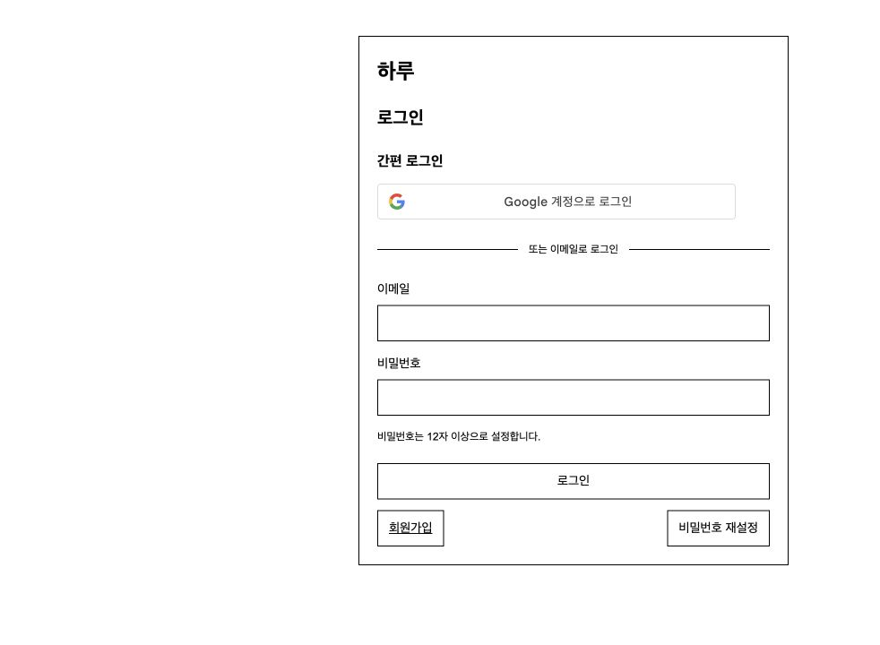
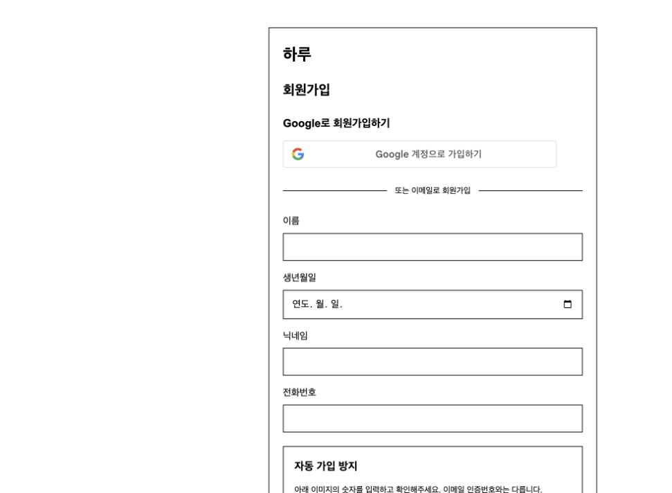

# 운영·외부 서비스 연결

Gmail, Google, Supabase 안내를 통합했다. 아래 설정·확인 기록은 원문에 적힌 당시 상태이며 이번 문서 정리에서 외부 연결이나 발송을 새로 검증한 것은 아니다. 비밀값은 `.env`에 보관하고 문서에 복사하지 않는다.

현재 구조는 [전체 구조](architecture.md), 확인 범위는 [검증 기록](verification.md)를 참고한다.

---

## Gmail 연결 안내

선택한 방식: 파이썬 서버가 인증번호를 생성·검증하고 Gmail SMTP가 메일을 발송한다. Google 방문자 로그인과 별개의 설정이다.

기존 확인 기록: 사용자의 앱 비밀번호 입력 후 암호화 연결·계정 인증·테스트 메일 접수를 확인했고 서버에도 반영했다. 사용자가 실제 메일함 도착까지 확인했다. 홈페이지에서의 가입 인증번호 요청·입력 확인은 별도로 진행한다.

### 준비된 설정

- 발신 주소는 사용자가 지정한 계정으로 `backend/.env`에 설정했다.
- `MAIL_MODE=smtp`, `SMTP_PROVIDER=gmail`, `SMTP_HOST=smtp.gmail.com`, `SMTP_PORT=587`.
- `SMTP_USER`와 `SMTP_FROM`은 동일한 발신 Gmail 주소다.
- `SMTP_PASSWORD`는 사용자가 로컬에서 입력했다. 이 문서에 비밀값을 복사하지 않으며 Gmail 계정의 일반 비밀번호를 사용하지 않는다.
- `.env`는 소유자만 읽고 쓸 수 있는 권한(600)이며 버전 관리에서 제외한다. 공개 API에 발송 계정·비밀번호를 반환하지 않는다.

### 직접 해야 하는 계정 설정

1. 발신용 Google 계정으로 로그인한다.
2. [앱 비밀번호 페이지](https://myaccount.google.com/apppasswords)를 연다. 앱 비밀번호에는 2단계 인증이 필요하다. 조직·고급 보호 등의 계정 정책 때문에 이 기능이 제공되지 않을 수 있다. [Google 공식 안내](https://support.google.com/accounts/answer/185833?hl=ko)
3. 계정에서 `하루 메일 발송`용 앱 비밀번호를 발급한다. Google 본인 확인과 비밀번호 발급은 계정 소유자가 직접 진행한다.
4. 발급한 값은 채팅에 보내지 않고 로컬 터미널에서 다음 명령으로 입력한다. 입력 문자는 화면에 표시되지 않는다.

```sh
cd /Users/kimheejun/Desktop/kimheejun/project1/backend
.venv312/bin/python scripts/configure_gmail.py
```

또는 `.env`의 `SMTP_PASSWORD=` 뒤에 직접 입력한다. 설정 파일을 공유하지 않는다. 도구는 Gmail에 표시되는 앱 비밀번호의 공백을 제거하여 사용한다.

### 연결 검사

TLS 연결과 계정 인증만 검사하며 메일은 발송하지 않는다:

```sh
.venv312/bin/python scripts/check_gmail.py
```

발신 계정 자신의 메일함으로 연결 확인 메일 한 통을 보낸다:

```sh
.venv312/bin/python scripts/check_gmail.py --send-test
```

발송 서비스의 접수 성공과 메일함 도착은 다르다. 받은편지함과 스팸함에서 실제 도착을 확인한다. 이 테스트 메일은 회원가입 인증번호가 아니다.

### 사이트에 적용

설정을 변경한 뒤 API 서버를 재시작한다:

```sh
.venv312/bin/uvicorn app.main:app --reload --host 127.0.0.1 --port 8000
```

이미 같은 포트에서 API 서버가 실행 중이면 먼저 그 서버를 종료한다. 홈페이지를 새로고침한 뒤 이미지 캡차 확인 → 인증 메일 요청 → 받은 6자리 번호 입력을 확인한다.

Gmail 설정이 불완전하면 연결 대기를 안내하고 실제 발송을 거절한다. 실패했는데 인증번호를 화면에 표시하거나 발송 완료로 안내하지 않는다. 개발 환경의 자동 모드는 SMTP 호스트가 없으면 미리보기를 사용할 수 있다. 실제 SMTP 모드의 발송 실패를 미리보기로 대신하지 않는다. 운영에서는 미리보기를 허용하지 않는다.

### 선택 이유와 운영 한계

현재 단기 프로젝트에서는 AWS 발신 인증·제한 해제·발송 이벤트 운영을 추가하기보다 실제 수신 흐름을 완성하는 쪽을 우선했다. Gmail의 계정 발송 제한을 감수한다. 지속적인 공개 운영·반송 및 스팸 신고 추적이 필요하면 SES 같은 전용 서비스를 재검토한다. [Gmail 발송 제한](https://support.google.com/mail/answer/22839?hl=en)


---

## Google 로그인 연결 안내

기준: 2026-10-13, 로컬 개발 환경.

### 설정한 내용

Google Auth Platform에서 우리 사이트를 웹 애플리케이션으로 등록했다. 클라이언트 이름은 `하루`이며 승인된 JavaScript 원본은 다음 두 개다.

```text
http://localhost
http://localhost:5173
```

공개 클라이언트 ID는 `backend/.env`의 `GOOGLE_CLIENT_ID`에 저장했다. 이 파일에는 비공개 Gmail 설정도 있으므로 파일 전체를 공유하지 않는다. 서버를 재시작했고 로그인 화면의 간편 로그인 버튼과 회원가입 화면 상단의 Google 가입 버튼을 별도로 표시한다.

현재 구현은 Google Identity Services의 JavaScript 콜백으로 결과를 받는다. 클라이언트 비밀번호와 승인된 리디렉션 URI는 사용하지 않는다. 사이트의 요청 주소를 허용하는 설정과 실제 회원의 Google 계정 인증은 별개다.

### 사용자가 확인할 흐름

1. 처음 가입한다면 `http://localhost:5173/`에서 `회원가입`을 누르고 상단의 `Google 계정으로 가입하기`를 선택한다.
2. Google 계정을 선택한 뒤 추가 정보 화면에서 이름·닉네임, 숫자 이미지 캡차와 개인정보 동의를 완료한다. 개인정보 안내는 개발용 초안이다. Google 인증만으로 회원을 만들지 않는다.
3. 가입을 완료하면 로그인 상태로 캘린더가 나오는지 확인한다.
4. 이미 가입했다면 로그인 화면의 간편 로그인 영역에서 `Google 계정으로 로그인`을 선택한다. 미가입 계정이면 회원가입으로 이동하는 안내를 표시하고 회원을 만들지 않는다.
5. 기존 회원이 Google 가입을 선택하면 로그인으로 이동하는 안내를 표시한다. 가입 요청을 기존 회원의 로그인으로 대신 처리하지 않는다.

이미 이메일·비밀번호로 가입한 이메일과 같으면 자동으로 계정을 합치지 않는다. 기존 방식으로 로그인한 뒤 `나의 정보`에서 비밀번호 재확인과 연결 동의를 거쳐 Google 계정을 연결한다.

### 검증 범위

웹 클라이언트 유형·허용 주소, 서버 설정 적용, 공개 설정 응답과 두 화면의 공식 Google 버튼 표시를 확인했다. API 테스트는 Google 인증을 대체하여 회원가입·로그인·연결 구분을 확인한다. 실제 Google 계정 인증·신규 가입·기존 로그인·기존 계정 연결은 아직 확인하지 않았다. 버튼이 보인다는 사실만으로 전체 Google 연동 검증 완료로 표시하지 않는다.

`POST /api/auth/google`은 `intent`로 `login`·`signup`·`link`를 구분한다. 생략하면 `login`이며 신규 회원을 만들지 않는다. `signup`은 필수 정보·개인정보 동의·캡차를 확인한 뒤 회원을 만들고, `link`는 기존 로그인·CSRF·비밀번호 재확인·연결 동의를 검사한다.

배포할 때에는 실제 HTTPS 홈페이지 주소를 승인된 원본에 추가하고 해당 환경에서도 다시 검증해야 한다. 현재 로컬 주소 등록은 운영 배포를 대신하지 않는다.





공식 설정 안내: [Google Identity Services 설정](https://developers.google.com/identity/gsi/web/guides/get-google-api-clientid)

공식 버튼의 로그인·가입 문구 설정: [Google JavaScript API](https://developers.google.com/identity/gsi/web/reference/js-reference#text)


---

## Supabase 연결 진행 상태

2026-10-13 기준 public 스키마의 최신 모델 10개 테이블을 생성했고 RLS를 활성화했다. 브라우저 anon/authenticated 역할의 테이블 접근은 차단했다. 기존 FastAPI 인증을 유지하며 서버의 PostgreSQL 연결을 사용한다.

### 비밀값 입력

백엔드 폴더에서 `.venv312/bin/python setup_supabase.py`를 실행하고 프로젝트 DB 비밀번호를 숨김 입력한다. 입력은 `.env`의 `SUPABASE_DATABASE_URL`에 저장되며 이 단계에서는 홈페이지의 `DATABASE_URL`을 바꾸지 않는다. 비밀번호를 채팅·Git에 넣지 않는다.

### 검증과 이전

1. ` .venv312/bin/python migrate_to_supabase.py`로 연결과 빈 대상 DB를 확인한다.
2. API 서버를 중지하여 로컬 쓰기를 멈춘다.
3. `.venv312/bin/python migrate_to_supabase.py --apply --switch`로 회원·일기·반복 설정·날짜별 할 일·댓글을 이전한다.
4. 도구는 원본 백업, 대상 테이블 잠금, 빈 DB 검사, 동일 ID 보존, 데이터 전체 읽기 비교, 자동 증가 시퀀스 조정을 수행한다. 기존 대상 데이터가 있으면 병합하지 않고 중단한다.
5. 로그인·재발급 토큰·이메일 인증·캡차·요청 제한은 이전하지 않는다. 사용자는 다시 로그인한다.
6. 백엔드를 재시작하고 로그인·일기 조회·저장을 검증한다.

DB 데이터 커밋과 로컬 .env 수정은 하나의 트랜잭션이 아니다. 데이터 이전 후 설정 변경이 실패했다면 대상 내용을 확인한 뒤 설정만 복구한다. 빈 DB 조건 때문에 이전을 무작정 반복하지 않는다.

현재 상태: 2026-10-13 Supabase 접속 및 데이터 이전, DATABASE_URL 전환, API 서버 재시작 완료. 회원 2명·일기 2개·반복 설정 2개·날짜별 할 일 3개·댓글 0개를 원본과 전체 값 비교 후 커밋했다. 원본 SQLite와 backups의 사본을 보존했다. 홈페이지·API config·프록시 응답 HTTP 200 확인. 사용자 로그인·개인 일기 기능 및 동시성 검증은 미완료. 샘플 로그인 후 비공개 기록 조회는 자동 승인 검토에서 차단되어 실행하지 않았다. SSL 연결을 요구하며 인증서 신원 검증 강화와 애플리케이션 전용 최소 권한 DB 역할은 운영 전 검토한다.
